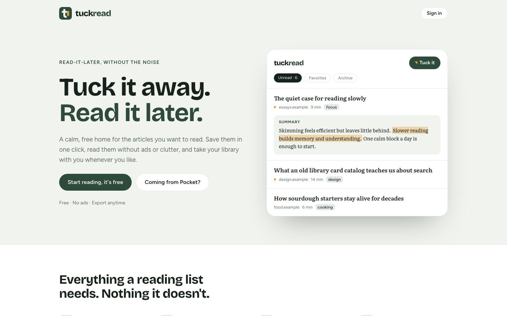

<p align="center">
  
</p>

<h1 align="center">Tuckread</h1>

<p align="center">
  <strong>Tuck it away. Read it later.</strong><br>
  A calm, free read-it-later app. Save articles in one click, read them without ads or clutter,<br>
  and take your library with you whenever you like.
</p>

<p align="center">
  
  
  
  
  
</p>

<picture>
  <source media="(prefers-color-scheme: dark)" srcset="docs/screenshots/landing-dark.png">
  
</picture>

## Why Tuckread

Mozilla shut down **Pocket** in July 2025 after 17 years, and the open-source **Omnivore** closed in late 2024.
The paid alternatives that remain cost around $10 a month. Tuckread is a free, focused replacement that
respects the reader: no ads, no tracking, and an export button that is always there.

## Features

**Working today**

- **Save by link.** Paste a URL and Tuckread fetches the page, pulls out the article with
  [Mozilla Readability](https://github.com/mozilla/readability) (the engine behind Firefox Reader View),
  and estimates the reading time.
- **Clean reading view.** Typeset in Literata, a face designed for long-form reading on screens, in light or dark.
- **Library and archive.** Unread articles up top; archive them when you are done, or delete them.
- **Graceful fallback.** Sites that block reading apps (Medium, for example) are saved as link-only
  bookmarks with a title derived from the URL, instead of failing.
- **Accounts.** Email and password sign-up with email confirmation.

**On the roadmap**

- [ ] Browser extension that saves the page as you see it, including sites that block servers
- [ ] Import from Pocket and Instapaper export files
- [ ] Export your whole library as Markdown or JSON
- [ ] Three-sentence AI summaries
- [ ] Highlights and notes in the reading view
- [ ] Tags and search

## How it is built

| Layer | Choice |
| --- | --- |
| Framework | Next.js 16 (App Router, Server Actions, Cache Components, `proxy.ts`) |
| UI | React 19, Tailwind CSS 4, `next/font` (Bricolage Grotesque, Figtree, Literata) |
| Auth and database | Supabase Auth and Postgres via `@supabase/ssr` |
| Article parsing | `@mozilla/readability` on `jsdom`, cleaned with `sanitize-html` |

### Security notes

- **Row Level Security on every table.** Each signed-in user can only read and write their own rows.
  New tables are not exposed to the Data API automatically; access is granted explicitly to signed-in users only,
  so anonymous requests get `permission denied`. See [`supabase/migrations`](supabase/migrations).
- **SSRF protection.** Saving a link makes the server fetch a URL, so every hop (including redirects) is
  resolved and rejected if it points at localhost, private networks or cloud metadata addresses.
  Requests have a 10-second timeout and a 5 MB size limit. See [`src/lib/articles/extract.ts`](src/lib/articles/extract.ts).
- **Sanitized HTML.** Article content is stripped of scripts, iframes, forms and event handlers when it is saved,
  and sanitized again before it is rendered.
- **Session handling.** `src/proxy.ts` refreshes the Supabase session on every request and keeps signed-out
  visitors out of `/library` and `/read`. Server code verifies the user with `getUser()` before touching data.
- **Respecting site rules.** When a site blocks automated readers, Tuckread does not try to disguise itself;
  it saves the link instead.

## Getting started

### Prerequisites

- Node.js 20.9 or newer
- A free [Supabase](https://supabase.com) project

### 1. Install

```bash
git clone https://github.com/FatihMuradovich/tuckread.git
cd tuckread
npm install
```

### 2. Set up Supabase

1. In the Supabase dashboard, open **SQL Editor**, paste the contents of
   [`supabase/migrations/20261111120000_initial_schema.sql`](supabase/migrations/20261111120000_initial_schema.sql)
   and run it.
2. Under **Authentication → URL Configuration**, set the Site URL to `http://localhost:3000` and add
   `http://localhost:3000/**` to the Redirect URLs.
3. Copy the environment template and fill in your project URL and **publishable** key
   (**Connect → App Frameworks → Next.js** in the dashboard):

   ```bash
   cp .env.example .env.local
   ```

   Never put the secret or `service_role` key in this file.

### 3. Run

```bash
npm run dev
```

Open [http://localhost:3000](http://localhost:3000), create an account, confirm your email, and save your first article.

## Project structure

```text
src/
├── app/
│   ├── page.tsx              Landing page
│   ├── login/                Sign in and sign up (Server Action + useActionState)
│   ├── auth/callback/        Email confirmation handler
│   ├── auth/signout/         Sign out
│   ├── library/              Library list, save form and article actions
│   └── read/[id]/            Reading view
├── components/               Logo and app header
├── lib/
│   ├── articles/             Fetching, parsing and sanitizing articles
│   ├── supabase/             Browser, server and proxy clients
│   └── auth.ts               requireUser() helper used by every private page and action
└── proxy.ts                  Session refresh and route protection
supabase/migrations/          Database schema and RLS policies
brand/                        Logo, favicon, color tokens and brand board
```

## Brand

Moss green (`#2E4A3B`) and marigold (`#E8A33D`) on a soft paper background. The logo is a lowercase
"t" whose crossbar turns into a bookmark ribbon. Colors, fonts and the icon live in [`brand/`](brand).

## Author

Built by [FatihMuradovich](https://github.com/FatihMuradovich) as a portfolio project.
